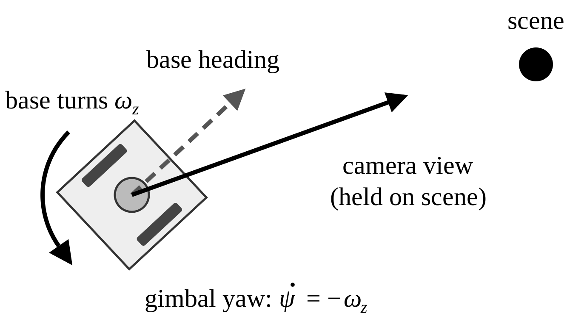
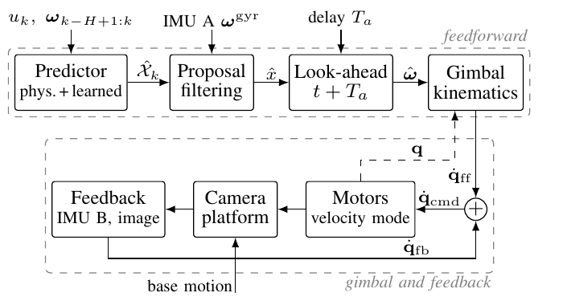
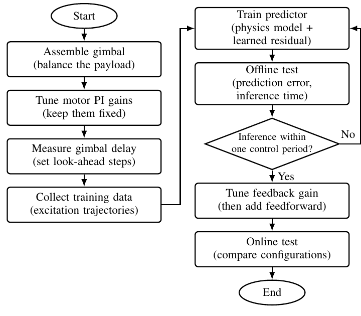

# Prediction-Assisted Three-Axis Gimbal Stabilization on a Differential-Drive Robot

Maxim Hugo Häfner, Tian-Yun Tanya Liu, Ting-Yi Nick Shi, Lennart Christopher Lux, Tzu-Chien Joey Tseng, Min-Fan Ricky Lee

*Markdown version of [`../Bravo_Team.pdf`](../Bravo_Team.pdf). The PDF is the authoritative version. Figures are in [paper_figures/](paper_figures/).*

---

**Abstract**: Base motion and actuation delay challenge camera stabilization on mobile robots. This study proposes prediction-assisted control for a three-axis gimbal on a differential-drive robot. A hybrid predictor combines a wheel-command-based physical model with learned residual trajectories generated by flow matching. Multiple predictions are weighted using gyroscope measurements from the gimbal base. Their weighted mean provides a delay-aware angular-velocity prediction, which gimbal kinematics converts into feedforward joint-rate commands. Visual orientation feedback corrects residual errors, with an inertial measurement unit-based inner loop planned for disturbance rejection. Hardware evaluation will compare the combined controller with feedback-only stabilization to assess whether prediction reduces camera-orientation error during robot motion. The proposed framework accounts for prediction timing and actuator constraints; its performance remains to be experimentally validated.

**Index Terms**: Feedforward systems, generative AI, mobile robots, motion compensation, prediction methods, visual servoing.

## I. Introduction

Base rotation of a mobile robot disturbs its camera, and a gimbal that reacts only to measured motion lags behind because its motors respond with a delay. Stable camera orientation is essential for visual tasks such as target tracking, especially during sharp turns. Gaze stabilization compensates motion from the robot's own commands [1], and visual servoing corrects residual error from images [2]; this study extends command-based compensation to a differential-drive base, whose motion is uncertain due to motor lag and wheel slip. It remains open whether command-based prediction can improve stabilization beyond feedback alone under such uncertainty and actuation delay. This study combines physics-based and flow-matching prediction [3], [4] with gyroscope-weighted proposals and feedforward–feedback control for evaluation on a differential-drive robot.

## II. Method

This study predicts robot base motion from wheel commands for delay-aware gimbal compensation. Figure 1 illustrates yaw-only motion: the gimbal compensates the base yaw rate $\omega_z$ with $\dot\psi = -\omega_z$, where both rates are expressed in rad/s.

*Fig. 1. Yaw compensation during robot turning.*

The robot carries a three-axis camera gimbal. Inertial measurement unit (IMU) A measures angular velocity at the gimbal base, while IMU B measures residual motion on the camera platform. Figure 2 summarizes the prediction and feedback paths. Their combined joint-rate command drives the motors in velocity mode; visual feedback corrects residual orientation error. The feedback block includes the planned IMU-based inner loop; the control equations specify the visual outer-loop contribution. Command limiting is included in the motor-command path.

In Fig. 2, $\hat{\mathcal{X}}_k$ denotes the set of $M$ candidate state trajectories, and $\hat{\mathbf{x}}$ denotes the weighted state prediction passed to the look-ahead block. The sequence $\boldsymbol\omega_{k-H+1:k}$ contains the latest $H$ base angular-velocity samples, and $\boldsymbol\omega^{\mathrm{gyr}}$ denotes the IMU A gyroscope measurement.

*Fig. 2. Prediction-assisted gimbal control architecture.*

**Table I. Control architecture signals**

| Signal | Meaning | Unit |
|---|---|---|
| $u_k$ | Right/left wheel angular-speed commands | rad/s |
| $\boldsymbol\omega$ | Base angular velocity in the base frame | rad/s |
| $\hat{\boldsymbol\omega}$ | Predicted base angular velocity at $t + T_a$ | rad/s |
| $\dot{\mathbf{q}}_{\mathrm{ff}}$ | Feedforward gimbal joint-rate command | rad/s |
| $\dot{\mathbf{q}}_{\mathrm{fb}}$ | Feedback gimbal joint-rate correction | rad/s |

### A. Three-Axis Gimbal Kinematics Model

Let $\{W\}$, $\{B\}$, and $\{C\}$ denote the world, base, and camera frames. The matrix ${}^A R_B$ maps vectors from frame $\{B\}$ to frame $\{A\}$. Define $\mathbf{q} = [\psi, \theta, \phi]^T$ as the yaw, pitch, and roll joint angles in radians.

Assuming an aligned mounting frame, the outer yaw, middle pitch, and inner roll joints rotate about the base $z$-axis, subsequent local $y$-axis, and subsequent local $x$-axis, respectively. Positive rotations follow the right-hand rule. The camera orientation is

$$
{}^W R_C = {}^W R_B \, R_z(\psi) \, R_y(\theta) \, R_x(\phi) \, R_0, \tag{1}
$$

where $R_0$ maps the camera frame to the innermost gimbal frame.

Rotation composition follows the general modeling approach in [5]; the axis sequence used here is an explicit hardware assumption, to be verified together with joint offsets and mounting alignment. The matrices $R_x$, $R_y$, and $R_z$ denote right-handed elementary rotations about the corresponding axes.

The angular-velocity relationship is

$$
\begin{aligned}
{}^B\boldsymbol\omega_{C/W} &= {}^B\boldsymbol\omega_{B/W} + J^B_\omega(\mathbf{q})\,\dot{\mathbf{q}}, \\
J^B_\omega(\mathbf{q}) &= \begin{bmatrix} 0 & -\sin\psi & \cos\psi\cos\theta \\ 0 & \cos\psi & \sin\psi\cos\theta \\ 1 & 0 & -\sin\theta \end{bmatrix}.
\end{aligned} \tag{2}
$$

Here ${}^B\boldsymbol\omega_{C/W}$ and ${}^B\boldsymbol\omega_{B/W}$ are the angular velocities of the camera and base relative to the world, respectively, both expressed in the base frame in rad/s. The joint-rate vector is $\dot{\mathbf{q}} = [\dot\psi, \dot\theta, \dot\phi]^T$, and $J^B_\omega$ maps joint rates to angular velocity expressed in the base frame.

Ideal stabilization requires ${}^B\boldsymbol\omega_{C/W} = \mathbf{0}$, consistent with kinematic gaze compensation [1].

The Jacobian is singular when $\cos\theta = 0$. Damping limits command amplification but cannot restore the lost degree of freedom. Rotational compensation does not fully eliminate image motion caused by translation and scene depth.

### B. Disturbance Model

Base-motion prediction combines a physical model with a learned angular-velocity residual [3]:

$$
x_{k+1} = f(x_k, u_k) + L\, r_k, \tag{3}
$$

where $f$ is a physics-based one-step prediction and $r_k \in \mathbb{R}^{d_r}$ is a residual capturing effects not covered by $f$. The selection matrix $L \in \{0,1\}^{d_x \times d_r}$ adds the residual to the angular velocity $\boldsymbol\omega_k$ of the gimbal base, so $d_r = 3$. The state dimension is $d_x = 4$. For the state ordering used here, $L = \begin{bmatrix} \mathbf{0}_{1\times3} \\ I_3 \end{bmatrix}$, where $I_3$ is the $3\times3$ identity matrix.

This physics-informed framework has been shown to improve learning and generalization and is therefore broadly applied in both control and dynamics learning [6]–[8].

Although (3) is a one-step model, the learned model jointly predicts the residual trajectory $\hat R_k = (\hat r_{k|k}, \dots, \hat r_{k+F-1|k}) \in \mathbb{R}^{F\times d_r}$. It is conditioned on $\mathcal{C}_k = (u_k, \boldsymbol\omega_{k-H+1:k})$. The wheel command is assumed constant over the prediction horizon. History length $H$ and horizon $F$ are listed in Table II. The state prediction is obtained by rolling out (3):

$$
\begin{aligned}
\hat x_{k+j+1|k} &= f(\hat x_{k+j|k}, u_k) + L\,\hat r_{k+j|k}, \\
\hat x_{k|k} &= x_k, \qquad j = 0, \dots, F-1.
\end{aligned} \tag{4}
$$

#### 1) Physical Model

The physical model describes the planar motion of the differential-drive robot using the commanded angular velocities of its right and left wheels. These commands form the input vector $\mathbf{u} = [\Omega^{\mathrm{cmd}}_R, \Omega^{\mathrm{cmd}}_L]^T$. The corresponding desired forward speed and yaw rate are given by

$$
\begin{cases}
v^{\mathrm{cmd}} = \dfrac{r}{2}\left(\Omega^{\mathrm{cmd}}_R + \Omega^{\mathrm{cmd}}_L\right), \\[2ex]
\omega^{\mathrm{cmd}}_z = \dfrac{r}{b}\left(\Omega^{\mathrm{cmd}}_R - \Omega^{\mathrm{cmd}}_L\right).
\end{cases} \tag{5}
$$

The state is $\mathbf{x} = [v, \omega_x, \omega_y, \omega_z]^T$, where $v$ is forward speed and $\boldsymbol\omega = L^T\mathbf{x}$ is base angular velocity in the forward–left–up frame. Motor response is approximated by first-order dynamics:

$$
\begin{cases}
\dot v = \dfrac{1}{\tau_v}\left(v^{\mathrm{cmd}} - v\right), \\[2ex]
\dot\omega_z = \dfrac{1}{\tau_\omega}\left(\omega^{\mathrm{cmd}}_z - \omega_z\right).
\end{cases} \tag{6}
$$

Here $k$ is the discrete-time index, and $j$ is the prediction-step offset. The notation $\hat{\mathbf{x}}_{a|b}$ denotes the state predicted for step $a$ using information available through step $b$.

The planar physical model sets $\omega_x = \omega_y = 0$; unmodeled angular motion is represented by the learned residual. The time constants are identified from step responses. Discretization with period $\Delta t$ defines $f$ in (3). Parameters are summarized in Table II.

**Table II. Platform and prediction parameters**

| Parameter | Symbol | Value | Unit |
|---|---|---|---|
| Wheel radius | $r$ | | m |
| Track width | $b$ | | m |
| Speed time constant | $\tau_v$ | | s |
| Yaw-rate time constant | $\tau_\omega$ | | s |
| Control period | $\Delta t$ | | s |
| Actuation delay | $T_a$ | | s |
| History length | $H$ | | samples |
| Prediction horizon | $F$ | | steps |
| Trajectory samples | $M$ | | – |
| Flow integration steps | $N$ | | – |

#### 2) Learned Model and Proposal Filtering

The residual trajectory $\hat R_k$ is predicted jointly over the horizon, because recursive one-step prediction compounds errors, and probabilistically, because the context does not determine the future uniquely. Flow Matching [4] meets both requirements. Unlike deterministic Long Short-Term Memory (LSTM) models [9], [10], it is generative. Unlike Gaussian Processes, it does not scale cubically with dataset size and is not limited to unimodal Gaussian distributions [11]. With linear paths, it also needs far fewer integration steps than Denoising Diffusion Probabilistic Models [12], [13].

The training dataset contains $N_D$ pairs of contexts $\mathcal{C}^{(i)}$ and residual trajectories $R^{(i)} \in \mathbb{R}^{F\times d_r}$. The residuals $r_{k+j} = L^\top\left(x_{k+j+1} - f(x_{k+j}, u_{k+j})\right)$ are the part of the recorded transitions not explained by the physical model. A network with parameters $\eta$ learns a vector field $v_\eta$ that transports Gaussian noise $Z^0 \sim \mathcal{N}(0, I)$ into this distribution. The variable $\tau \in [0,1]$ is a dimensionless flow-integration time, distinct from physical time. $Z^\tau \in \mathbb{R}^{F\times d_r}$ is the evolving residual-trajectory sample, with $\tau_n = n/N$. At inference, $v_\eta$ is integrated with $N$ Euler steps of size $\Delta\tau = 1/N$: For $n = 0, \dots, N-1$, the Euler update is

$$
Z^{\tau_{n+1}} = Z^{\tau_n} + \Delta\tau\, v_\eta(Z^{\tau_n}, \mathcal{C}_k, \tau_n), \tag{7}
$$

giving $\hat R_k = Z^{\tau_N}$. Drawing $M$ samples from independent noise yields proposals $\hat{\mathcal{X}}^{(m)}_k = (\hat x^{(m)}_{k+1|k}, \dots, \hat x^{(m)}_{k+F|k})$ through (4). These proposals can cover several modes of the future, for example wheel slip on varying terrain.

Each proposal defines a hypothesis $H_m$ whose angular-velocity error is modeled as $\mathcal{N}(0, P_j)$ with $P_j = (p_0 + j\,p_1) I_3$. Here $p_0$ is the initial angular-velocity error variance, and $p_1$ is its variance increment per prediction step; both have units of $(\mathrm{rad/s})^2$.

Following multiple model estimation [14]–[16], the weight $w^{(m)}_{k+j}$ is the posterior of $H_m$ given the IMU A gyroscope measurements up to $k+j$. Starting from $w^{(m)}_k = 1/M$, it is updated as

$$
w^{(m)}_{k+j} \propto w^{(m)}_{k+j-1} \exp\!\left(-\tfrac{1}{2}\, \boldsymbol\nu^{(m)\top}_{k+j} \left(\Sigma^{\mathrm{gyr}} + P_j\right)^{-1} \boldsymbol\nu^{(m)}_{k+j}\right), \tag{8}
$$

where $\boldsymbol\nu^{(m)}_{k+j} = \boldsymbol\omega^{\mathrm{gyr}}_{k+j} - L^\top \hat x^{(m)}_{k+j|k}$ and $\Sigma^{\mathrm{gyr}}$ is the measurement noise covariance. The weights are normalized to sum to one and computed in the log domain. The Gaussian normalization constant cancels because all proposals share the same covariance. The proposals are open-loop predictions with temporally correlated errors, so treating successive measurements as independent is an approximation that makes the weights overconfident. The prediction for future steps $j < i \le F$ is the weighted mean

$$
\hat x_{k+i|k+j} = \sum_{m=1}^{M} w^{(m)}_{k+j}\, \hat x^{(m)}_{k+i|k}. \tag{9}
$$

### C. Gimbal Controller

The controller combines kinematic compensation [1] with visual orientation feedback [2]. At control time $t$, the feedforward input is the predicted base angular velocity at $t + T_a$. Timestamp-based selection accounts for elapsed inference and filtering time; the prediction horizon must cover the actuation time.

Define the corrective orientation error as $\mathbf{e}^C_R = \mathrm{Log}({}^C R_{C_d})^\vee$, where ${}^C R_{C_d}$ maps the desired camera frame to the current camera frame. The logarithm and vee operator produce a rotation vector expressed in the current camera frame. Operation is restricted away from the ambiguity at a rotation angle of $\pi$.

Let $J = J^B_\omega(\mathbf{q}(t))$ and $J^\#_\lambda = J^T (J J^T + \lambda^2 I_3)^{-1}$, where $\lambda > 0$ is the damping parameter and $K_R$ is a positive-definite orientation-feedback gain matrix. The commands are

$$
\begin{cases}
\dot{\mathbf{q}}_{\mathrm{ff}} = -J^\#_\lambda \, {}^B\hat{\boldsymbol\omega}_{B/W}(t + T_a), \\
\dot{\mathbf{q}}_{\mathrm{fb}} = J^\#_\lambda \, {}^B R_C \, K_R \, \mathbf{e}^C_R, \\
\dot{\mathbf{q}}_{\mathrm{cmd}} = \mathrm{Limit}(\dot{\mathbf{q}}_{\mathrm{ff}} + \dot{\mathbf{q}}_{\mathrm{fb}}).
\end{cases} \tag{10}
$$

Here ${}^B R_C = R_z(\psi) R_y(\theta) R_x(\phi) R_0$, $K_R$ has units of inverse seconds, and $\mathrm{Limit}$ enforces joint-angle, velocity, and acceleration constraints.

Using the current configuration assumes small joint motion during $T_a$; otherwise the predicted configuration must be used. An IMU-based inner loop is planned, subject to the motor-driver interface.

Visual correction must account for image timestamps, moving objects, and translation-induced parallax. Initial tests will use static, distant scenes or rotation-dominant motion.

### D. Development Procedure

The system development procedure is summarized in Fig. 3. Motor proportional–integral (PI) gains remain fixed after initial tuning, and the measured actuation delay determines the prediction look-ahead. Offline tests check prediction error and inference time before hardware integration.

Online evaluation will compare prediction-assisted and feedback-only stabilization; performance and stability remain to be validated.

*Fig. 3. Development procedure.*

## References

1. A. Roncone and U. Pattacini, "Gaze Stabilization for Humanoid Robots: A Comprehensive Framework," in *2014 IEEE-RAS International Conference on Humanoid Robots*. IEEE, 2014, pp. 259–264.
2. F. Chaumette and S. Hutchinson, "Visual Servo Control. I. Basic Approaches," *IEEE Robotics & Automation Magazine*, vol. 13, no. 4, pp. 82–90, Dec. 2006.
3. Y. Yu, H. Yao, and Y. Liu, "Aircraft dynamics simulation using a novel physics-based learning method," *Aerospace Science and Technology*, vol. 87, pp. 254–264, Apr. 2019.
4. Y. Lipman, R. T. Q. Chen, H. Ben-Hamu, M. Nickel, and M. Le, "Flow matching for generative modeling," in *The Eleventh International Conference on Learning Representations*, 2023.
5. Z. Xin, "A Hierarchical Stabilization Control Method for a Three-Axis Gimbal Based on Sea–Sky-Line Detection," *Sensors*, vol. 22, no. 7, p. 2587, Mar. 2022.
6. T. Li, H. Lu, H. Li, and X. Zheng, "Diffusion-based 4D Trajectory Prediction and Distributed Control for UAV Swarms," *arXiv (Cornell University)*, Jun. 2026.
7. S. Zhou and A. P. Schoellig, "Active Training Trajectory Generation for Inverse Dynamics Model Learning with Deep Neural Networks," in *Proceedings of the IEEE Conference on Decision & Control, Including the Symposium on Adaptive Processes*, Dec. 2019, pp. 1784–1790.
8. F. Shiming and K. W. Yu, "Fine-tuning hybrid dynamics with physics-informed neural networks for vehicle dynamics estimation," *International Journal of Intelligent Robotics and Applications*, vol. 9, no. 4, pp. 1594–1610, Apr. 2025.
9. J. Gibson, B. Vlahov, D. Fan, P. Spieler, D. Pastor, A.-a. Agha-mohammadi, and E. A. Theodorou, "A Multi-step Dynamics Modeling Framework For Autonomous Driving In Multiple Environments," May 2023.
10. C. Han and X. Hu, "A Prediction Method of Ship Motion Based on LSTM Neural Network with Variable Step-Variable Sampling Frequency Characteristics," *Journal of Marine Science and Engineering*, vol. 11, no. 5, p. 919, 2023.
11. L. Hewing, J. Kabzan, and M. N. Zeilinger, "Cautious Model Predictive Control Using Gaussian Process Regression," *IEEE Transactions on Control Systems Technology*, vol. 28, no. 6, pp. 2736–2743, Nov. 2019.
12. J. Ho, A. Jain, and P. Abbeel, "Denoising diffusion probabilistic models," 2020.
13. X. Liu, C. Gong, and Q. Liu, "Flow straight and fast: Learning to generate and transfer data with rectified flow," 2022.
14. M. Athans and C. Chang, "Adaptive Estimation and Parameter Identification Using Multiple Model Estimation Algorithm," Tech. Rep., Jun. 1976.
15. D. Magill, "Optimal adaptive estimation of sampled stochastic processes," *IEEE Transactions on Automatic Control*, vol. 10, no. 4, pp. 434–439, 1965.
16. D. Lainiotis, "Optimal adaptive estimation: Structure and parameter adaption," *IEEE Transactions on Automatic Control*, vol. 16, no. 2, pp. 160–170, 1971.

## Authors

- **Maxim Hugo Häfner**: National Taiwan University of Science and Technology, Taipei, Taiwan, and Technical University of Berlin, Germany (m.haefner@campus.tu-berlin.de).
- **Tian-Yun Tanya Liu**: National Taiwan University of Science and Technology, Taipei, Taiwan (M11512004@mail.ntust.edu.tw).
- **Ting-Yi Nick Shi**: National Taiwan University of Science and Technology, Taipei, Taiwan (M11512010@mail.ntust.edu.tw).
- **Lennart Christopher Lux**: National Taiwan University of Science and Technology, Taipei, Taiwan, and University of Stuttgart, Germany (st173999@stud.uni-stuttgart.de).
- **Tzu-Chien Joey Tseng**: National Taiwan University of Science and Technology, Taipei, Taiwan (M11412009@mail.ntust.edu.tw).
- **Min-Fan Ricky Lee**: Graduate Institute of Automation and Control, National Taiwan University of Science and Technology, Taipei, Taiwan (rickylee@mail.ntust.edu.tw).
